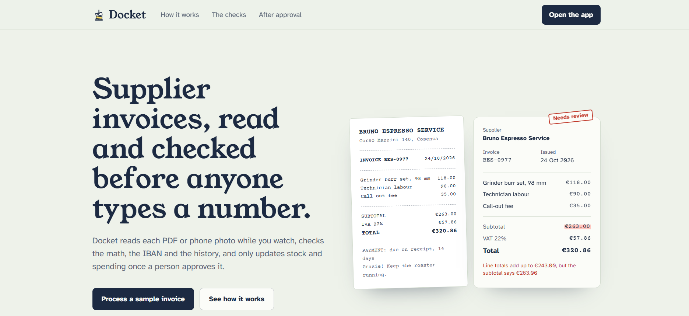
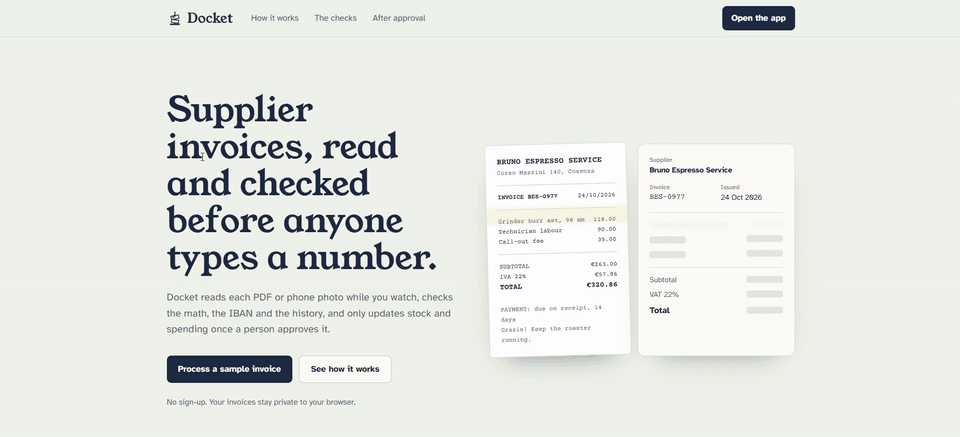
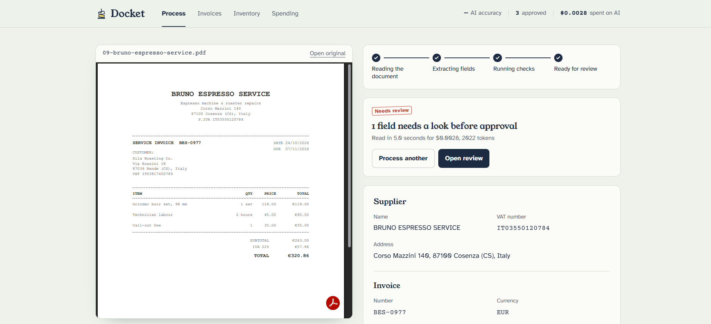
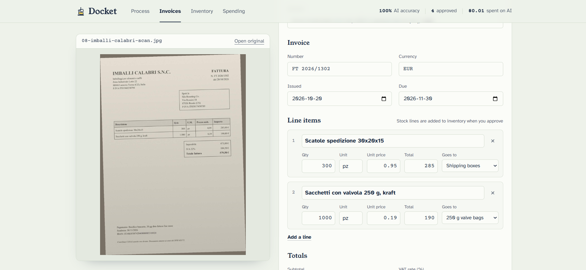
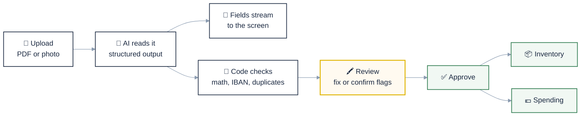

# Docket

AI invoice processing for a small coffee roaster. Upload a supplier invoice and watch the fields fill in as the AI reads it. Code checks the math, the IBAN, duplicates and price changes, and you fix or confirm anything flagged. Only approved invoices update inventory and spending.

**Live app:** https://docket-extraction.vercel.app



## Demo



| Live extraction | Review with flags |
|---|---|
|  |  |

## What it does

- Reads PDFs and phone photos of supplier invoices, in English and Italian
- Streams every field to the screen as the model writes it
- Returns a fixed structure through OpenAI structured outputs, so the form always matches the data
- Checks line totals, subtotal, VAT and total, plus IBAN checksums, VAT number formats and required fields
- Flags duplicates (same supplier VAT number and invoice number) and price increases over 10%
- Highlights doubtful fields in red or yellow with the reason, and blocks approval until every red field is fixed or confirmed
- Logs each correction against the AI's original value, which turns into an accuracy figure
- Matches each line to a stock item or an expense category, and updates inventory and spending on approval
- Exports approved invoices as CSV (one row per line item) or JSON

Each visitor gets a private copy of the roaster's inventory and a few example invoices, so anyone can try every case without affecting other visitors.

## Sample invoices

Twelve invoices from six fictional suppliers, generated by a script with a different layout for each supplier. The same script writes the correct values for each one, which the eval uses.

| Invoice | Tests |
|---|---|
| Altura Green Coffee (2) | Green beans into stock, then an 18% price jump |
| Imballi Calabri (2) | An Italian invoice, and a crooked, grainy phone photo |
| SpeedLine Logistics (2) | Shipping, then the same invoice resent |
| Bruno Espresso Service (2) | Repairs, then a subtotal that doesn't match its lines |
| Energia Sud (2) | Electricity bills with flat charges |
| Pulito Pro (2) | Cleaning services mixed with a stock item |

## How it works



**One schema.** A Pydantic model defines the invoice. It is the structured output schema sent to OpenAI, the shape of the API responses, and the source of the frontend's TypeScript types, which are generated from the OpenAPI spec.

**Streaming.** FastAPI sends Server-Sent Events with the stages and the partial fields as the model writes them. The browser reads the stream through a Next.js proxy, so the frontend, the API and the visitor cookie all share one domain with no CORS setup.

**The AI guesses, the rules decide.** The model reports fields it isn't sure about. Plain Python checks then run on every value and add their own flags. Red flags block approval until a person fixes the value or confirms it's right. Editing any field runs the checks again straight away.

**Approval does the bookkeeping.** Stock lines raise the item's quantity and update its last price, which the next price check compares against. Expense lines go to spending by category.

**Swappable pieces.** File storage, the model and the export each sit behind one small module, ready for S3, another model or an accounting system.

## Evaluation

`backend/eval` runs all 12 sample invoices through the model and compares them with the answer files. It scores 11 fields per invoice plus the quantity, unit price, total and match of every line. It also checks that the planted problems are caught, and counts red flags on values that were actually right.

| | gpt-5.4-mini | gpt-5.4 |
|---|---|---|
| Field accuracy | 100% | 100% |
| Line accuracy | 100% | 100% |
| Planted problems caught | 3 of 3 | 3 of 3 |
| False alarms | 0 | 0 |
| Cost per invoice | $0.0033 | $0.0096 |
| Time per invoice | 4.3 s | 4.2 s |

gpt-5.4-mini gives the same accuracy at a third of the cost, so it is the default. On the blurry phone photo it misread one digit of the IBAN in 2 of 3 runs, and the IBAN checksum check flagged it for review each time. That is the case the checks are there for.

```bash
cd backend
python -m eval.run_eval
python -m eval.run_eval --model gpt-5.4
```

Full results are in `backend/eval/results`.

## Limits and hosting

- With `DEMO_MODE=true`, each visitor can run 10 extractions a day and the whole app 150. Both numbers come from environment variables.
- Visitors are told apart by an anonymous cookie, with no sign-in.
- A daily scheduled job deletes visitors idle for 7 days, along with their uploads. The endpoint is protected by a secret.
- The frontend and the API are two Vercel projects. The API runs in Frankfurt, next to the Neon database.

## Stack

- **Frontend:** Next.js 16 (App Router), TypeScript, Tailwind CSS v4
- **Backend:** FastAPI, Pydantic, SQLAlchemy, Alembic
- **AI:** OpenAI Responses API with structured outputs and streaming
- **Data:** Postgres, with uploaded files stored behind a storage module
- **Hosting:** Vercel for both apps, Neon for the database, Vercel Schedules for the cleanup job

## Run locally

You need Python 3.12 or later, Node.js 20 or later, Docker and an OpenAI API key.

Start the database:

```bash
docker compose up -d
```

Backend:

```bash
cd backend
python -m venv .venv
.venv\Scripts\activate          # on macOS or Linux: source .venv/bin/activate
pip install -r requirements.txt
cp .env.example .env            # then add your OPENAI_API_KEY
alembic upgrade head
uvicorn app.main:app --reload --port 8000
```

Frontend, in a second terminal:

```bash
cd frontend
npm install
cp .env.example .env.local
npm run dev
```

Open http://localhost:3000 for the app, and http://localhost:3000/api/docs for the API docs.

To regenerate the sample invoices:

```bash
cd backend
pip install -r requirements-dev.txt
python -m scripts.make_samples
```

## Project structure

```
backend/
  app/
    extraction/     schema, prompt, streaming model call, pricing
    rules/          normalizing, math and format checks, duplicates, price alerts
    services/       invoices, reports, storage, visitors, limits, cleanup
    routers/        documents, extraction, invoices, inventory, reports, cron
    models/         SQLAlchemy tables
  alembic/          migrations
  eval/             eval runner and results
  scripts/          sample invoice generator and test scripts
  sample_data/      invoices, answer files, starting inventory
  vercel.json       function settings and the daily schedule
frontend/
  app/              landing page and the app under /app
  components/       landing, upload, extraction, review, invoices, inventory, spending
  lib/api/          typed API client, stream reader, generated types
docker-compose.yml
```
